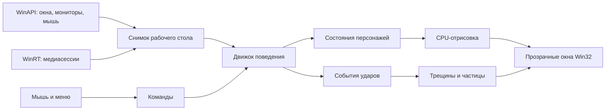

# Архитектура Rust-версии

Основа — `kerimovernes/claude-mascot`, исходный коммит `d89e93b`.
Rust-приложение находится в отдельном каталоге `rust/` и собирается в нативный
Windows x64 `.exe`. Исходная Python-версия доступна отдельно.

## Устройство

| Модуль | Ответственность |
| --- | --- |
| `lib.rs` | Координаты, прямоугольники, описание окон и снимок мира |
| `engine.rs` | Физика, состояния, сон, погоня, поверхности, лазание, ярость и взаимодействия питомцев |
| `render.rs` | Рисование Клода, спрайты Тагиллы, реплики, сердечки, масштабирование и PNG-превью |
| `effects.rs` | Временные трещины и осколки, привязанные к конкретному окну |
| `platform.rs` | WinAPI, DPI, мониторы, HWND, прозрачность, меню, трей и обработка ввода |
| `media.rs` | Получение подтверждённых видеосессий Windows в фоновом потоке |
| `settings.rs` | Версионный JSON, сохранение настроек и пользовательский автозапуск |
| `main.rs` | Сборка модулей, цикл приложения, создание и удаление питомцев |

## Почему так

Для пиксельного персонажа достаточно собственного небольшого CPU-рендерера
и `UpdateLayeredWindow`. Поэтому здесь нет WebView, браузерного интерфейса
или игрового движка. Спрайты встроены в исполняемый файл, шрифт берётся из
Windows. Python и Rust пользователю устанавливать не требуется.

Движок поведения получает данные о рабочем столе, но сам не вызывает WinAPI.
Его можно проверять без окон Windows: задавать положение курсора, закрывать
виртуальные окна, менять мониторы и воспроизводить одинаковые сценарии.
Случайность определяется состоянием генератора каждого питомца.

Все платформенные координаты — физические пиксели виртуального рабочего
стола. Поддерживаются отрицательные координаты мониторов. Per-monitor-v2 DPI
задаётся до создания окон. Пользовательский масштаб 75/100/150% меняет
отрисовку персонажа, сохраняя точку опоры между ступнями.

## Цикл и ресурсы

- Физика обновляется фиксированным шагом 1/60 секунды. После задержки цикл
  ограничивает число догоняющих шагов, чтобы персонаж не пролетал сквозь окна.
- Видимые чужие окна опрашиваются примерно раз в 33 мс; при паузе или скрытии —
  раз в 250 мс. Медиасессии проверяются отдельно раз в 1,5 секунды.
- Отрисовка ограничена сверху примерно 60 обновлениями в секунду. Реальная
  частота зависит от таймеров Windows и нагрузки.
- До восьми питомцев живут в одном процессе. Есть отдельное ограничение на
  восемь одновременных эффектов.
- Каждый нативный хост владеет своим HWND, bitmap и DC. При удалении питомца
  освобождаются и окно, и графические ресурсы.
- Длительный запрос WinRT не блокирует главный поток и выход приложения.

Поверхность хранит идентификатор окна: перестановка окон в списке не переносит
питомца на другое окно. Закрытие окна снимает опору. Трещины тоже следуют за
идентификатором окна и исчезают, если оно закрывается.

Удар передаётся наружу как типизированное событие с порядковым номером.
Приложение обрабатывает каждый удар один раз и создаёт косметический эффект.
Окна с эффектами прозрачны для ввода: трещины не мешают работать с приложением.

## Настройки и расширение

Настройки лежат в `%LOCALAPPDATA%\claude-mascot-rust\settings.json`.
Запись сначала выполняется во временный файл, затем файл заменяется.
Неизвестная версия или повреждённый JSON показывают ошибку вместо скрытого
сброса предпочтений.

Автозапуск включается пользователем через меню либо параметр `Install.ps1
-Autostart`. Запись создаётся в текущем профиле Windows. Обычный запуск `.exe`
автозапуск не включает.

Замена спрайтов Тагиллы задаётся через PNG и JSON с координатами кадров.
Это данные без исполняемого кода; размеры изображения и границы кадров
проверяются. Для нового вида поведения расширяется движок, для нового способа
отображения — рендерер. Будущий Linux-хост может использовать тот же движок
и рендерер, реализовав собственный сбор снимка мира и оконный слой.

## Практические границы

Это Windows-версия с собственной архитектурой и упрощёнными маршрутами и
тактиками персонажей. Она не повторяет покадрово всю Python-реализацию.
Настоящее отбрасывание системного курсора не перенесено: атака курсора
остаётся анимацией. Нативный Rust-хост для Linux пока отсутствует.

Подглядывание использует подтверждённую медиасессию типа Video. Если приложение
не сообщает такой тип, эффект не включается. Определение конкретного окна
основано на процессе медиаприложения; при нескольких его окнах выбор остаётся
эвристикой. Сложное прятание за окном и точные маршруты оригинала упрощены.

## Проверки

Автотесты проверяют опоры и перекрытие окон, падения, перенос движущимся окном,
его закрытие и смену порядка, сон и пробуждение, захват курсора, команды,
взаимодействие питомцев, альфа-канал, спрайты и настройки. Отдельный нативный
тест создаёт и удаляет 50 окон и контролирует GDI/USER-ресурсы.

Результаты конкретной сборки и оставшиеся ручные проверки записаны в
[`verification.md`](verification.md). Смешанный DPI, разные мониторы и
видеоплееры требуют проверки на соответствующем оборудовании.
